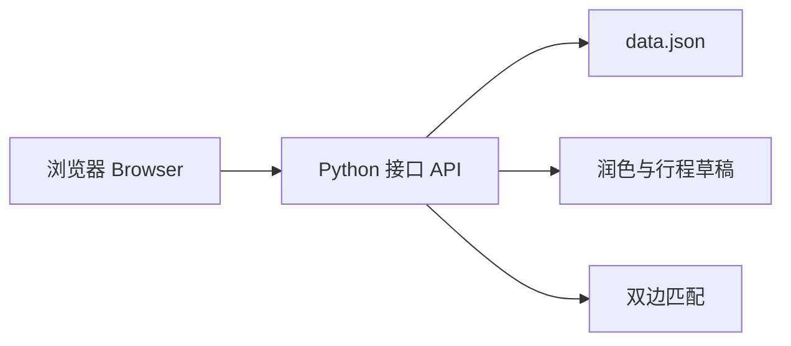

<p align="center">
  
</p>

<h1 align="center">青禾 · Qinghe</h1>

<p align="center">
  找位本地人，陪你慢慢逛。<br>
  Find a local, and wander the city slowly.
</p>

<p align="center">
  
  
</p>

青禾是香港教育大学 INT6181 的课程项目。旅人可以预约本地地陪，熟悉城市的人也可以发布自己的服务。现在能用的是地陪：浏览、预约、私聊，以及下面的 AI 功能。

Qinghe is a course project for EdUHK INT6181. Travellers book a local guide. People who know a city can publish their own service. What works today is the guide service: browse, book, chat, and the AI features below.

## 目录 / Contents

- [快速开始 / Quick start](#快速开始--quick-start)
- [能做什么 / What it does](#能做什么--what-it-does)
- [怎么搭的 / How it is built](#怎么搭的--how-it-is-built)
- [AI](#ai)
- [测试 / Tests](#测试--tests)
- [参考 / Reference](#参考--reference)

## 快速开始 / Quick start

需要 **Python 3.10** 或更高版本。预约和私聊只用 Python 自带的库，不用再安装别的。

You need **Python 3.10** or newer. Booking and chat use only Python’s own libraries. Nothing else to install.

| 系统 / System | 启动 / Start |
| --- | --- |
| Windows | 双击 `start.bat`，或运行 `.\start.ps1`。 Double-click `start.bat`, or run `.\start.ps1`. |
| macOS / Linux | 运行 `bash start.sh`。 Run `bash start.sh`. |

也可以直接运行 `python main.py --serve`。macOS / Linux 如果 `python` 不可用，就用 `python3`。

You can also run `python main.py --serve`. On macOS / Linux, use `python3` when `python` is not available.

打开 <http://127.0.0.1:4173>。终端不要关。按 **Ctrl+C** 停止。macOS / Linux 也可以运行 `bash stop.sh`。

Open <http://127.0.0.1:4173>. Leave the terminal open. Press **Ctrl+C** to stop. On macOS / Linux, `bash stop.sh` also works.

默认地址是 `127.0.0.1:4173`。用 `HOST` 和 `PORT` 修改。用 `PYTHON_BIN` 指定用哪一个 Python。端口被占用时会启动失败。不要同时开两个服务去改同一份数据。

The default address is `127.0.0.1:4173`. Change it with `HOST` and `PORT`. Set `PYTHON_BIN` to pick a Python program. Startup fails if the port is already taken. Do not run two servers on the same data.

**演示账号 / Demo account：** `demo@qinghe.cn`，密码 `qinghe123`。登录框里也可以点「一键体验」。里面已有一条已确认的上海预约、一条已完成的杭州预约、一条暂停的服务、一份个人资料，以及两段私聊。

**Demo account:** `demo@qinghe.cn`, password `qinghe123`. You can also click 一键体验 in the login dialog. It already has a confirmed Shanghai booking, a completed Hangzhou booking, one paused service, a profile, and two chats.

**命令行 / Command line：** 不带参数运行 `python main.py`，会进入菜单：查地陪、算报价、开网站、跑测试。报价不会创建预约。

**Command line:** `python main.py` with no arguments opens a menu: look up guides, estimate a price, start the site, or run tests. An estimate does not create a booking.

**重置 / Reset：** 先停掉服务，再运行 `python main.py --reset`。Windows 也可以用 `.\start.ps1 --reset`。这会清空用户、预约、私聊和上传的图片，并恢复演示数据。如果留下 `server/server.pid`，先确认服务已经关闭，再删掉这个文件。

**Reset:** Stop the server, then run `python main.py --reset`. On Windows, `.\start.ps1 --reset` also works. This clears users, bookings, chats, and uploaded images, and restores the demo data. If `server/server.pid` is left behind, delete it only after the server has stopped.

## 能做什么 / What it does

| | 中文 | English |
| --- | --- | --- |
| 🗺️ 地陪 | 在 151 座城市里搜索、看套餐、预约。人数 1–8。超过 4 人，每人加 ¥60。 | Search 151 cities, pick a package, and book for 1–8 people. Above 4 people, each extra person adds ¥60. |
| 📝 发布 | 发布地陪服务，也可以暂停或恢复接单。预置 6 位地陪，演示账号另有 1 条暂停的服务。 | Publish a guide service, then pause or resume it. Six sample guides are included, plus one paused service on the demo account. |
| 💬 私聊 | 旅人和地陪在站内聊天，大约每 4 秒看一次新消息。 | Travellers and guides chat on the site. New messages are checked about every 4 seconds. |
| 🖼️ 资料 | 头像、封面，以及最多 6 张照片。简介可以先预览，再决定要不要换成润色后的文字。 | An avatar, a cover, and up to 6 photos. You can preview a polished bio before keeping it. |
| 🤝 匹配 | 双方填好偏好后，给出双向推荐。需要额外安装，见下方 AI。 | After both sides fill in preferences, the site suggests matches both ways. Extra install; see AI below. |

摄影、模特、博物馆讲解员、NPC 只出现在页面预告里，现在还不能用。

Photography, modelling, museum guides, and NPC only appear as previews. They cannot be used yet.


## 怎么搭的 / How it is built

页面是浏览器里的 HTML、CSS 和 JavaScript，不用打包。接口是 Python 自带的网页服务。数据写在 `server/data.json`，不是数据库。上传的图片放在 `public/uploads/`。

The pages are HTML, CSS, and JavaScript in the browser. There is no build step. The API is Python’s built-in web server. Data is stored in `server/data.json`, not a database. Uploaded images go in `public/uploads/`.



密码用加盐的 scrypt 保存，接口不返回密码。登录后的令牌大约 7 天内有效。

Passwords are stored with salted scrypt. The API does not return them. A login token lasts about 7 days.

## AI

三块都在这个仓库里。润色和「帮我写」默认不需要密钥。匹配要另外安装 PyTorch。

All three live in this repo. Polish and profile drafts need no API key by default. Matching needs PyTorch installed separately.

### 文字润色 / Polish

把已经写好的文字改得更顺。先给你看结果，你再决定换不换。不配置模型时，用本地规则完成。个人简介最多 160 字，地陪介绍最多 600 字。

It tidies text you already wrote, shows you the result, and waits for you to accept it. With no model configured, local rules do the work. A profile bio is at most 160 characters. A guide intro is at most 600.

### 帮我写简介和行程 / Profile and itinerary draft

这个功能现在就能用。登录后请求 `POST /api/ai/profile-draft`。

This is available now. While logged in, call `POST /api/ai/profile-draft`.

写 6 到 300 个字，并选好城市。返回一段简介、正好 3 条亮点，以及三套行程：半日 4 小时、全天 8 小时、傍晚 3 小时。地点只来自你写的内容。地名不够时，用「沿途散步」「自由拍照」这类节点补上，不会编一个你没写过的店。

Write 6–300 characters and choose a city. You get a bio, exactly 3 highlights, and three timelines: a 4-hour half day, an 8-hour full day, and a 3-hour evening. Places come only from your notes. If there are not enough place names, the draft uses generic stops such as “沿途散步” and “自由拍照”. It does not invent a venue you never wrote.

不配置模型时，由 `server/ai_draft.py` 在本机生成。外部模型必须只返回 JSON。格式、字数、时间或地点不合格时，自动改用这个本地引擎。润色和草稿共用 `QINGHE_POLISH_*`。

With no model configured, `server/ai_draft.py` generates the draft on this machine. An outside model must return JSON only. If the format, length, times, or places are not valid, the server switches to that local engine. Polish and drafts share `QINGHE_POLISH_*`.

`variant` 取 0 到 20 的整数，用来换一版。超出范围返回 **400**。每个账号 60 秒内最多 8 次，再请求返回 **429**。可以用 `QINGHE_DRAFT_RATE_LIMIT` 和 `QINGHE_DRAFT_RATE_WINDOW` 调整。

`variant` is an integer from 0 to 20 and asks for another version. A value outside that range returns **400**. Each account may call it 8 times in 60 seconds; the next call returns **429**. Change that with `QINGHE_DRAFT_RATE_LIMIT` and `QINGHE_DRAFT_RATE_WINDOW`.

发布服务时可以带上 `highlights` 和 `itineraries`。不带的话，亮点用默认句子，套餐没有行程。

When publishing a service you can send `highlights` and `itineraries`. If you leave them out, highlights use the default lines and the packages have no itinerary.

### 双边匹配 / Two-sided matching

旅人填一条行程，地陪填希望接待什么样的人。系统先看城市、语言、预算、人数和档期，再用一个很小的教学模型给双方各打一个分。分数只用来排序，不是“对方会答应”的概率。训练用的是人造数据。

A traveller describes one trip. A guide describes who they like to host. The site checks city, language, budget, group size, and schedule first, then a small teaching model scores the pair from both sides. The score is only for sorting. It is not the chance that someone will say yes. Training used synthetic data.

没装 PyTorch 时，预约和聊天仍然可用，推荐列表不可用。以前发布的服务要先补上偏好，系统不会替他们编。

Without PyTorch, booking and chat still work. The recommendation list does not. Older services must add preferences first. The site will not invent them.

```bash
python -m venv .venv
# Windows
.\.venv\Scripts\python.exe -m pip install -r requirements-matching.txt
.\.venv\Scripts\python.exe main.py --serve
# macOS / Linux
.venv/bin/python -m pip install -r requirements-matching.txt
.venv/bin/python main.py --serve
```

网站已经开着时，可以造一组对得上的测试账号。重复运行会更新原账号，不会再造一份。

With the site already running, you can create a matched set of test accounts. Running it again updates those accounts. It does not create a second set.

```bash
# macOS / Linux
.venv/bin/python tools/seed_matching_demo.py
# Windows
.\.venv\Scripts\python.exe tools/seed_matching_demo.py
```

账号是 `guide1`–`guide4@qinghe.test` 和 `traveler1`–`traveler4@qinghe.test`，密码是 `qinghe-test-2026`。页面在 `/matching`。算法说明见 [docs/MATCHING.md](docs/MATCHING.md)，图在 `训练图表/`。

The accounts are `guide1`–`guide4@qinghe.test` and `traveler1`–`traveler4@qinghe.test`. The password is `qinghe-test-2026`. The page is `/matching`. The write-up is [docs/MATCHING.md](docs/MATCHING.md). Charts are in `训练图表/`.

## 测试 / Tests

```bash
python -m unittest discover -s tests -v
```

没装 PyTorch 时，神经匹配的测试会跳过，其余测试照常运行。

Without PyTorch, the neural-matching tests are skipped. The other tests still run.

用户从头走到尾的故事在 `tests/test_user_journeys.py`，说明见 [docs/TESTING.md](docs/TESTING.md)。

Stories that follow a user from start to finish are in `tests/test_user_journeys.py`. See [docs/TESTING.md](docs/TESTING.md).

```bash
python -m unittest discover -s tests -p test_user_journeys.py -v
```

GitHub Actions 在 Ubuntu 和 Windows 上用 Python 3.10 和 3.12 跑测试。匹配测试另外用 Python 3.12，并安装 PyTorch。

GitHub Actions runs the tests on Ubuntu and Windows with Python 3.10 and 3.12. Matching tests run separately on Python 3.12 with PyTorch installed.

## 课程提交 / Course hand-in

课程要求的入口是 `main.py`。打包时把下面的 `3` 换成组号：

The required entry point is `main.py`. When you pack the project, replace `3` with your group number:

```bash
python tools/package_project.py --group 3
```

得到 `output/group3_project.zip`。包里没有你现在的账号、聊天、预约和上传图片。要求对照表在 [docs/COURSE_REQUIREMENTS.md](docs/COURSE_REQUIREMENTS.md)。

This writes `output/group3_project.zip`. The zip leaves out your current accounts, chats, bookings, and uploads. The checklist is [docs/COURSE_REQUIREMENTS.md](docs/COURSE_REQUIREMENTS.md).

## 接下来 / Next

| 中文 | English |
| --- | --- |
| 发布页上的「AI 帮我写」按钮，以及详情页上的行程时间线。方案在 [docs/AI_ITINERARY.md](docs/AI_ITINERARY.md)。接口本身已经可用。 | A “AI 帮我写” button on the publish page, and a timeline on the guide page. The plan is [docs/AI_ITINERARY.md](docs/AI_ITINERARY.md). The API itself is already available. |
| 摄影、模特、博物馆讲解员、NPC。 | Photography, modelling, museum guides, and NPC. |
| 这是课堂演示，没有支付、数据库和实名认证。 | This is a class demo. There is no payment, database, or identity check. |

## 致谢 / Thanks

演示照片来自 Unsplash 和 Wikimedia Commons。作者和许可写在 [CREDITS.md](./CREDITS.md)。页面用系统字体，图标是项目里画的。

Demo photos come from Unsplash and Wikimedia Commons. Authors and licences are in [CREDITS.md](./CREDITS.md). The pages use system fonts. The icons are drawn in the project.

## 参考 / Reference

<details>
<summary>环境变量 / Environment variables</summary>

| 变量 / Variable | 作用 / What it does | 默认 / Default |
| --- | --- | --- |
| `HOST` | 监听地址。 Listen address. | `127.0.0.1` |
| `PORT` | 端口。 Port. | `4173` |
| `PYTHON_BIN` | 指定 Python。 Which Python to run. | 自动找 3.10+。 Auto-detect 3.10+. |
| `QINGHE_POLISH_PROVIDER` | `local`、`openai`（含兼容接口）或 `anthropic`。 `local`, `openai` (including compatible APIs), or `anthropic`. | `local` |
| `QINGHE_POLISH_MODEL` | 外部模型名。外部提供方必填。 Outside model name. Required for an outside provider. | 空。 Empty. |
| `QINGHE_POLISH_BASE_URL` | 接口根地址，不要带 `/chat/completions`。 API root, without `/chat/completions`. | OpenAI 或 Anthropic 的官方地址。 The official OpenAI or Anthropic root. |
| `QINGHE_POLISH_API_KEY` | 密钥。只能放在环境变量里。 API key. Environment variable only. | 空。 Empty. |
| `QINGHE_POLISH_API_KEY_ENV` | 改用另一个变量存放密钥，例如 `ANTHROPIC_API_KEY`。 Read the key from another variable, such as `ANTHROPIC_API_KEY`. | `QINGHE_POLISH_API_KEY` |
| `QINGHE_POLISH_TIMEOUT` | 单次网络超时，单位秒。 Network timeout in seconds. | `20` |
| `QINGHE_POLISH_FALLBACK` | `local`：失败后改用本地引擎。`off`：直接报错。 `local` falls back to the local engine. `off` returns an error. | `local` |
| `QINGHE_POLISH_OPTIONS` | 合并进请求的 JSON，例如 `{"temperature": 0.7}`。 Extra JSON merged into the request, for example `{"temperature": 0.7}`. | `{}` |
| `QINGHE_POLISH_CONFIG` | 非密钥配置文件。 Config file for non-secret settings. | `server/ai_polish.local.json` |
| `QINGHE_DRAFT_RATE_LIMIT` | 每个账号在一个窗口里最多生成几次草稿。 Max drafts per account in one window. | `8` |
| `QINGHE_DRAFT_RATE_WINDOW` | 上面这个窗口有多少秒。 Window length in seconds. | `60` |

本机 Ollama 的例子。不需要密钥。

Example for local Ollama. No key is required.

```bash
export QINGHE_POLISH_PROVIDER=openai
export QINGHE_POLISH_BASE_URL=http://localhost:11434/v1
export QINGHE_POLISH_MODEL=qwen2.5:7b
```

不想每次都 `export` 时，把**不含密钥**的设置写进 `server/ai_polish.local.json`。这个文件不会进 git。文件里如果出现密钥字段，会被拒绝。环境变量优先。

To avoid exporting every time, put **non-secret** settings in `server/ai_polish.local.json`. That file is not committed. A secret field in the file is rejected. Environment variables win.

```json
{"provider": "openai", "base_url": "http://localhost:11434/v1", "model": "qwen2.5:7b", "timeout": 30}
```

`QINGHE_POLISH_FALLBACK=off` 时：配置错误返回 503，超时返回 504，其他失败返回 502。

With `QINGHE_POLISH_FALLBACK=off`: a bad configuration returns 503, a timeout returns 504, and other failures return 502.

</details>

<details>
<summary>帮我写：地名和时间 / Draft places and times</summary>

本地引擎从「去、在、逛、到」后面找地名。名字要以这些字结尾：公园、市场、街道、大街、巷子、路、街、巷、寺、馆、山、湖。「不赶路」这类普通词不会被当成地点。

The local engine looks for a place name after 去, 在, 逛, or 到. The name must end in 公园, 市场, 街道, 大街, 巷子, 路, 街, 巷, 寺, 馆, 山, or 湖. Ordinary words such as 不赶路 are not places.

默认开始时间：半日 10:00，全天 09:00，傍晚 17:00。`variant` 是奇数时，半日改从 13:00 开始。每个行程 3 到 5 个节点，时间均匀排开，首尾不超过套餐时长，而且必须越来越晚。傍晚不能早于 17:00。

Default start times: half day 10:00, full day 09:00, evening 17:00. When `variant` is odd, the half day starts at 13:00. Each itinerary has 3 to 5 stops, spaced evenly, inside the package length, and each time is later than the one before. An evening cannot start before 17:00.

`part` 可以是 `all`（默认）、`bio`、`highlights` 或 `itinerary`，用来只重写一块。

`part` may be `all` (the default), `bio`, `highlights`, or `itinerary`, when you want to rewrite only one block.

</details>

<details>
<summary>接口 / API</summary>

除了特别注明的，下面写「需登录」的接口都要带登录令牌。

Unless noted, routes marked “login” need a login token.

| 方法 | 路径 | 说明 / What it does |
| --- | --- | --- |
| POST | `/api/auth/register` | 注册并登录。 Register and log in. |
| POST | `/api/auth/login` | 登录。 Log in. |
| POST | `/api/auth/logout` | 退出。 Log out. |
| GET | `/api/auth/me` | 当前用户。 Current user. |
| PATCH | `/api/profile` | 改昵称、城市、简介。需登录。 Name, city, bio. Login. |
| POST | `/api/profile/photo` | 上传头像、封面或照片。需登录。 Upload an avatar, cover, or photo. Login. |
| DELETE | `/api/profile/photo` | 移除头像、封面或照片。需登录。 Remove one. Login. |
| GET | `/api/conversations` | 我的会话。需登录。 My chats. Login. |
| POST | `/api/conversations` | 打开和某位地陪的会话。需登录。 Open a chat with a guide. Login. |
| GET | `/api/conversations/:id/messages` | 读取消息并标为已读。需登录。 Read messages and mark them read. Login. |
| POST | `/api/conversations/:id/messages` | 发消息。需登录。 Send a message. Login. |
| GET | `/api/messages/unread` | 未读总数。需登录。 Unread count. Login. |
| POST | `/api/ai/polish` | 润色简介或地陪介绍。需登录。 Polish a bio or guide intro. Login. |
| POST | `/api/ai/profile-draft` | 生成简介、3 条亮点和行程。需登录。太频繁返回 429，`variant` 超出 0–20 返回 400。 Draft a bio, 3 highlights, and itineraries. Login. Too many calls return 429. A `variant` outside 0–20 returns 400. |
| GET | `/api/meta` | 城市、服务、语言等选项。 Cities, services, languages, and other choices. |
| GET | `/api/health` | 服务是否在跑。 Whether the server is up. |
| GET | `/api/guides` | 地陪列表，可筛选、排序。 Guide list, with filters and sorting. |
| GET | `/api/guides/:id` | 地陪详情。 One guide. |
| GET | `/api/guides/mine` | 我发布的服务。需登录。 Services I published. Login. |
| POST | `/api/uploads` | 上传封面等临时图片。需登录。 Upload a cover or other temporary image. Login. |
| POST | `/api/guides` | 发布服务。需登录。可选 3 条亮点（每条最多 20 字）和行程。 Publish a service. Login. Optional: 3 highlights (at most 20 characters each) and itineraries. |
| PATCH | `/api/guides/:id` | 暂停或恢复。仅发布者。 Pause or resume. Publisher only. |
| POST | `/api/bookings` | 创建预约。需登录。 Create a booking. Login. |
| GET | `/api/bookings/mine` | 我的预约。需登录。 My bookings. Login. |
| PATCH | `/api/bookings/:id/cancel` | 取消预约。需登录。 Cancel a booking. Login. |
| GET | `/api/matching/meta` | 匹配用的兴趣、节奏，以及模型是否就绪。 Interests, pace, and whether the model is ready. |
| GET / POST / DELETE | `/api/matching/trip` | 读取、保存或撤回我的行程。需登录。 Read, save, or withdraw my trip. Login. |
| PATCH | `/api/matching/preferences/:id` | 填写自己某项服务的接单偏好。需登录。 Set preferences on one of my services. Login. |
| GET | `/api/matching/guides` | 按我的行程推荐地陪。需登录，且已安装模型。 Suggest guides for my trip. Login, and the model must be installed. |
| GET | `/api/matching/travelers` | 按我的服务推荐行程。需登录，且已安装模型。 Suggest trips for my service. Login, and the model must be installed. |
| POST | `/api/matching/contact` | 地陪联系一条符合条件的行程。需登录。 A guide contacts a trip that passes the checks. Login. |

筛选例子 / Filter example:

```text
/api/guides?city=上海&service=城市漫步&language=英语&minPrice=200&maxPrice=400&sort=rating&q=咖啡
```

`sort` 可以是 `recommended`、`price-asc`、`price-desc`、`rating`、`popular`、`newest`。

`sort` may be `recommended`, `price-asc`, `price-desc`, `rating`, `popular`, or `newest`.

</details>

<details>
<summary>目录 / Layout</summary>

```text
qinghe/
├── main.py                 # 课程入口和命令行菜单 / course entry and menu
├── start.py                # 不带参数时直接开网站 / serves the site when run with no arguments
├── start.sh                # macOS / Linux
├── start.ps1  start.bat    # Windows
├── stop.sh
├── pyproject.toml
├── requirements-matching.txt
├── public/                 # 页面、样式、脚本、演示图片 / pages, styles, scripts, demo images
├── preview/                # 说明文档用的界面截图 / screenshots used in this README
├── 训练图表/                # 匹配模型的训练图 / matching-model charts
├── tests/
├── tools/                  # 训练、演示账号、课程打包 / training, demo accounts, course zip
├── docs/
└── server/
    ├── server.py           # HTTP 接口 / HTTP API
    ├── store.py            # JSON 存储 / JSON storage
    ├── pricing.py          # 报价 / price quote
    ├── ai_polish.py        # 本地润色 / local polish
    ├── ai_draft.py         # 本地简介和行程 / local bio and itinerary
    ├── polish_providers.py # 外部模型，润色和草稿共用 / outside models for polish and drafts
    ├── matching_*.py       # 双边匹配 / two-sided matching
    ├── catalog.json        # 城市和服务选项 / cities and service choices
    ├── seed-data.json      # 初始演示数据 / initial demo data
    └── models/             # 已训练好的教学模型 / trained teaching model
```

业务数据在首次启动时写成 `server/data.json`，不会提交到 git。

Business data is written to `server/data.json` on first launch. It is not committed.

</details>

<details>
<summary>更多截图 / More screenshots</summary>


</details>

<details>
<summary>数据与安全 / Data and safety</summary>

这是可以点、可以预约的课堂演示，不是能收款的正式产品。

This is a class demo you can click through and book in. It is not a product that can take payment.

用户、会话、服务、预约和私聊都在 `server/data.json`。图片在 `public/uploads/`。重启后还在。

Users, sessions, services, bookings, and chats live in `server/data.json`. Images live in `public/uploads/`. They remain after a restart.

上传只接受 JPG、PNG、WebP。服务端核对文件头，并限制 5MB。浏览器会先把长边压到 1600 像素，原始文件不能超过 15MB。

Uploads accept JPG, PNG, and WebP only. The server checks the file header and limits a file to 5MB. The browser first shrinks the long side to 1600 pixels. The original file cannot exceed 15MB.

模型密钥只从环境变量读取，不写进代码或仓库。私聊靠大约每 4 秒问一次服务器，不是长连接。

Model keys are read only from environment variables. They are not written into the code or the repo. Chat asks the server about every 4 seconds. It is not a live socket.

见面请留在公开场所，沟通请留在平台里。

Meet in public places, and keep the conversation on the platform.

</details>
