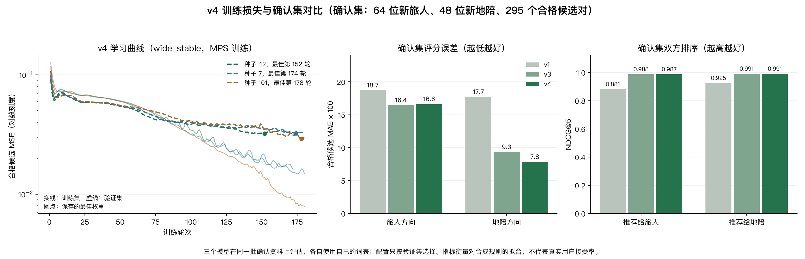

# 青禾 · 城市轻兼职

> 找位本地人，陪你慢慢逛。也把你的闲暇时间，变成一段新的旅程。

青禾是香港教育大学 INT6181 的课程项目，一个双端网站：**旅人**可以找懂城市的本地地陪，**熟悉城市的人**可以发布自己的地陪服务，把空闲时间变成一份副业。

- 覆盖 **34 个省级行政区、151 座城市**，当前重点打磨「地陪」板块；摄影、模特、博物馆讲解员、NPC 以「即将开放」入口预留。
- **双边匹配**：字符级 Transformer + 异构图神经网络，同时给出「旅人想不想选他」和「地陪想不想接这单」两个方向的分数。
- **AI 帮我写**：地陪只写几句熟悉的地方，就能得到简介、三条亮点和三份套餐行程；地点只取自用户写的内容，不替人编造。
- **AI 润色**：把已写好的简介改顺，先预览再替换。
- 后端只用 Python 标准库，前端是原生 HTML / CSS / JavaScript，无需构建步骤。

| 地陪详情 | 私聊消息 |
| --- | --- |
|  |  |
| **个人资料与照片墙** | **AI 文本润色** |
|  |  |

---

## 功能

**找地陪**
- 151 座城市按省份分组，可按城市、日期、服务类型搜索
- 按热门城市、服务、语言、价格、关键词筛选，支持多种排序
- 详情页包含照片画廊、介绍、亮点、套餐与行程时间线、评价和服务保障
- 预约时选择套餐、日期、时间和人数，超过 4 人自动加收服务费；可查看、取消、再次预约

**当地陪**
- 发布服务时带实时预览，封面可选预置图或自己上传
- 可随时暂停或恢复接单
- 写几句自己熟悉的地方，「AI 帮我写」生成第一人称简介、三条亮点，以及半日轻游、全天深度游、傍晚轻陪游三份行程；每一块都能单独换一版

**双边匹配**
- 旅人填写行程：城市、日期、时长、人数、预算、服务、语言、兴趣、节奏和描述
- 地陪填写接单偏好：接待人数、接单星期、休息日、兴趣和节奏
- 系统先排除条件不符的候选，再给出双方视角的分数和推荐理由；地陪可以直接联系推荐的旅人

**私聊与资料**
- 从地陪卡片、详情页或匹配结果发起私聊，双方都能回复，带未读提醒
- 个人资料支持头像、主页封面和最多 6 张照片墙
- 个人简介和地陪介绍都能用 AI 润色

**体验**
- 淡绿 + 白色视觉，适配桌面、平板和手机
- 灯箱、提示、确认弹窗、骨架屏和空状态；照顾减少动效偏好
- 基础无障碍：跳转链接、焦点样式、弹窗焦点循环、Esc 关闭

---

## 双边匹配是怎么做的

1. **硬条件筛选**：城市、共同语言、所需服务、对应时长的套餐、预算、地陪档期和接待人数不满足的候选直接排除。
2. **文本理解**：把旅人和地陪的资料各拼成一段文字，用字符级 Transformer 编码。
3. **关系传播**：旅人、地陪与城市、服务、语言、兴趣、节奏等属性组成异构图，每种关系各自传播信息。
4. **双向评分**：两个评分头分别给出旅人方向和地陪方向的分数，再用调和平均合成总分，任何一方不情愿都会拉低结果。

线上使用的是三个模型取平均的集成版本，训练时用了更贴近真实写法的合成文字，并随机遮盖部分字符，让模型对没见过的写法更稳。

> 模型只在**合成偏好数据**上训练，推荐分是排序参考，不是接受或成交概率；真实效果仍需真实数据验证。

---

## AI 帮我写与润色

两项 AI 功能默认由内置的本地引擎完成，不依赖外部服务；也可以接入 OpenAI 兼容接口、Ollama 或 Claude 等模型来获得更自然的文字。

- 「帮我写」只使用用户自己写到的地点，不凭空编造；行程时间对齐到一刻钟。
- 外部模型出错时会自动退回本地引擎，网站照常可用。
- 调用模型时不会卡住网站的其他请求。

---

## 关于这个项目

- 这是可交互的**课程演示项目**，不是生产级交易系统；没有接入支付、实名认证、短信验证和地图。
- 平台定位为正规的城市旅行陪伴服务，社区公约要求公开场所见面、平台内沟通，拒绝私下交易和越界邀约。
- 密码加盐哈希保存，上传图片会校验格式和大小，AI 接口密钥不会写进代码或仓库。

延伸阅读：[匹配算法完整说明](docs/匹配算法完整说明.md) · [优化实验报告](docs/OPTIMIZATION.md) · [AI 帮我写方案](docs/AI_ITINERARY.md) · [课程对照清单](docs/COURSE_REQUIREMENTS.md)

---

## 图片版权

演示图片来自 Unsplash 与 Wikimedia Commons，作者、来源和许可见 [CREDITS.md](./CREDITS.md)。用于正式产品时请替换为自有版权图片。
