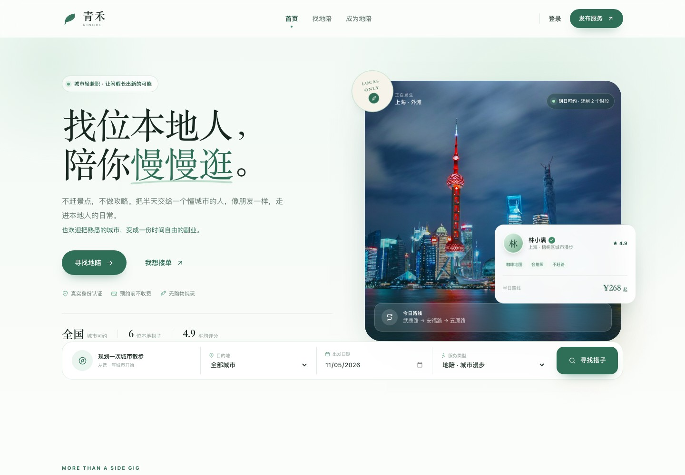
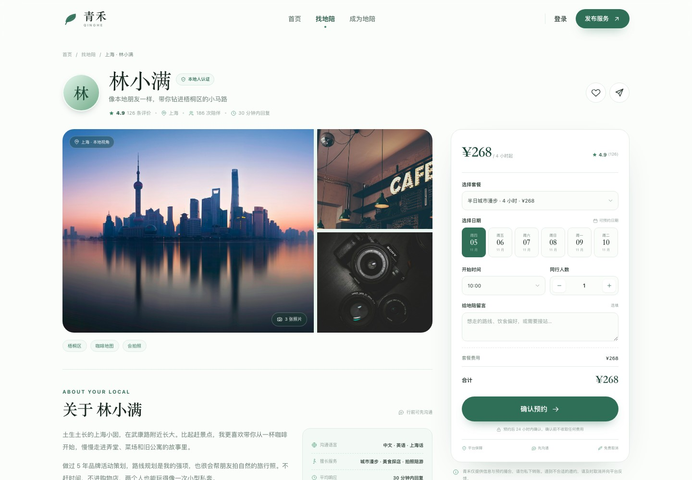
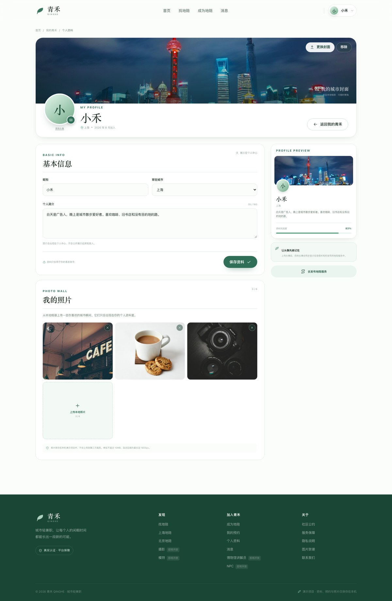
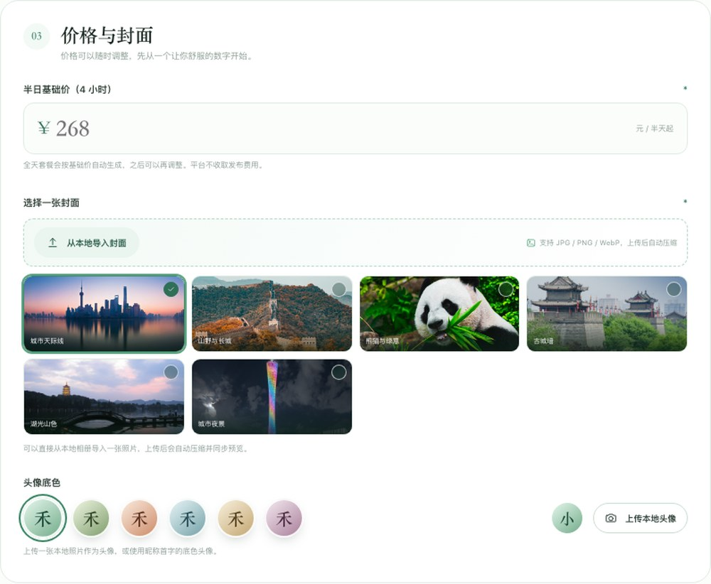
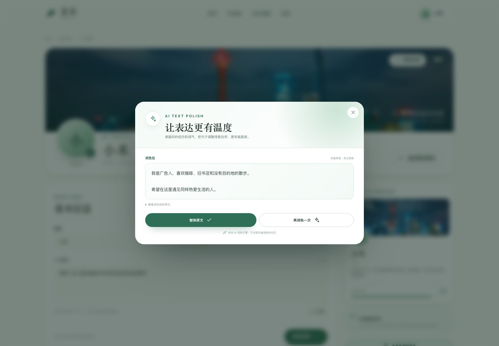
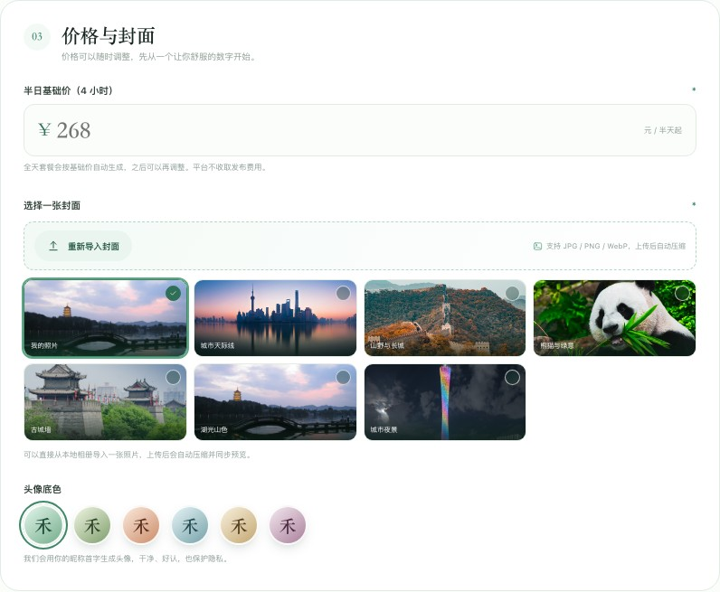
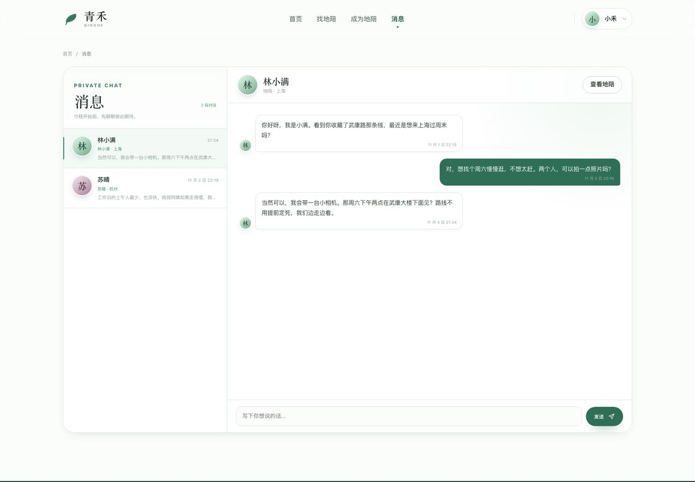

# 青禾 · 城市轻兼职

> 找位本地人，陪你慢慢逛。也把你的闲暇时间，变成一段新的旅程。

青禾是一个面向个人兼职与城市服务的双端网站：旅人可以找到懂城市的本地地陪，熟悉城市的人也可以发布自己的地陪服务，赚取一份时间自由的副业收入。

城市覆盖已从 6 个扩展到 **34 个省级行政区、151 座城市**，包含省会、直辖市与热门旅行目的地。当前版本重点打磨 **地陪** 板块。摄影、模特、博物馆讲解员、NPC 作为后续板块，已在首页与页脚中以「即将开放」的形式预留入口。















---

## 课程提交入口

INT6181 要求的 Python 入口是 `main.py`。在标准 Python 3.10+ 环境运行：

```bash
python main.py
```

进入命令行菜单，可查询地陪、选择套餐并计算 1–8 人报价、启动完整网页服务、运行测试。非法选项和人数会显示提示；EOF 或 Ctrl+C 可退出。查询和估价不创建预约。CLI 查询使用 JSON 文件输入，报价执行实际业务计算；完整账号、预约和私聊在浏览器界面完成。

课程要求对照、规格、测试、代码评审和展示提纲见 [课程对照清单](docs/COURSE_REQUIREMENTS.md)。

## 快速开始（Python 版）

需要 **Python 3.10 或更高版本**。基础预约、私聊等功能仅使用标准库，不需要 Node.js；新增神经双边匹配需额外安装 PyTorch 和 NumPy，见下文。前端继续使用浏览器原生 HTML、CSS 和 JavaScript。

Windows 下双击 `start.bat`，或在项目目录运行：

```powershell
.\start.ps1
```

启动脚本会寻找系统 Python，也支持本机已有的应用内置 Python。可通过环境变量 `PYTHON_BIN` 指定解释器路径。

已安装 Python 时，也可以直接运行：

```bash
python main.py --serve
# macOS / Linux
python3 main.py --serve
# 或使用脚本
bash start.sh
```

打开 [http://127.0.0.1:4173](http://127.0.0.1:4173)。保持终端窗口打开，按 **Ctrl+C** 关闭。macOS / Linux 也可运行 `bash stop.sh`。

默认监听 `127.0.0.1:4173`，可用环境变量 `HOST`、`PORT` 修改。端口已被占用时会提示启动失败；不要同时运行多个服务实例访问同一份数据。

### 演示账号

- 邮箱：`demo@qinghe.cn`
- 密码：`qinghe123`

演示账号预置了：
- 1 条已确认的上海地陪预约
- 1 条已完成的杭州地陪预约
- 1 条已暂停接单的个人服务（可在「我的服务」里恢复）
- 1 份带有城市封面、个人简介和 3 张照片的个人资料（可在「个人资料」查看和修改）
- 2 段已开始的私聊对话，可在「消息」中继续

也可以直接点击登录弹窗里的 **一键体验**。

### 双边匹配测试账号

预置地陪没有填写双边偏好，单靠演示账号无法看到推荐。服务启动后运行：

```bash
.venv/bin/python tools/seed_matching_demo.py
```

脚本通过网站接口创建 4 个上海地陪账号（`guide1`–`guide4@qinghe.test`，各自发布服务并填写偏好）和 4 个旅人账号（`traveler1`–`traveler4@qinghe.test`，各自发布行程），兴趣两两对应，并打印双方推荐结果。测试密码见脚本中的 `TEST_PASSWORD`。可重复运行，不会重复创建。

### 重置演示数据

先关闭服务，再运行（会清空现有用户、预约、私聊和上传图片）：

```powershell
.\start.ps1 --reset
# 或
python main.py --reset
```

重置完成后重新启动。若进程意外退出留下 `server/server.pid`，请确认服务已经关闭，再删除该文件后重置。

### 验证

```bash
python -m unittest discover -s tests -v
```

只运行 14 个用户功能故事（筛选与预约、雨天改订、地陪休假、多旅人私聊、照片墙和润色预览等）：

```bash
python -m unittest discover -s tests -p test_user_journeys.py -v
```

场景说明见 [测试文档](docs/TESTING.md)。这些场景通过真实接口验证用户功能，使用临时账号和数据。

测试使用独立临时数据，覆盖登录、旧密码兼容、预约计价、发布服务、双向私聊、上传、并发写入、启动与重置，不修改现有业务数据。

---

## Transformer + 异构图双边匹配

网页导航的 **双边匹配** 提供旅人和地陪两个视角：旅人填写行程，地陪填写接单偏好，系统先检查预算与档期，再用轻量 Transformer 和异构图神经网络计算双向推荐分。旧服务须先补充偏好，不会自动编造地陪的接受意愿。

```powershell
python -m venv .venv
.\.venv\Scripts\python.exe -m pip install -r requirements-matching.txt
.\.venv\Scripts\python.exe tools/train_matching.py --preset wide_compact --epochs 180
.\.venv\Scripts\python.exe main.py --serve
```

项目已提供通过合成确认集验收的三模型集成权重；普通训练输出候选到 output/matching_training，不覆盖当前权重。完整复验与晋级使用 tools/refine_matching.py。Windows 启动脚本优先使用 `.venv`。macOS / Linux 将解释器路径替换为 `.venv/bin/python`。无模型依赖时，原有基础功能仍可运行。

当前为三个独立种子的小模型集成，每个含 1 层 Transformer、1 层异构图传播、四个显式相容性输入和两个评分头，总计约 5.5 万参数。当前只在合成偏好数据上训练，分数不是接受概率，也没有真实推荐效果验证。详情、训练数据和评估边界见 [匹配算法说明](docs/MATCHING.md)。

## 功能清单

### 登录 / 注册
- 邮箱注册、登录、退出登录
- 密码使用 Python `hashlib.scrypt` 加盐哈希存储，不保存明文密码
- 基于 Bearer Token 的本地会话，有效期 7 天
- 登录状态持久化在浏览器 `localStorage`
- 未登录时预约会自动唤起登录弹窗，登录后继续完成预约
- 一键体验账号
- 登录、注册表单的前后端双重校验

### 地陪（核心板块）
- 全国 34 个省级行政区、151 座城市可选
- 首页地陪搜索：城市、出发日期、服务类型；城市按省份分组
- 地陪列表：全国热门城市快捷筛选 + 可搜索的「更多城市」弹层，支持服务、语言、价格、关键词筛选与多种排序
- 6 位预置地陪 + 1 位演示账号发布的服务
- 地陪详情：照片画廊、个人介绍、服务亮点、适合人群、套餐选择、真实评价、服务保障
- 预约流程：套餐、日期、时间、人数、留言、价格明细
- 超过 4 人自动计算额外服务费
- 预约成功弹窗与订单记录
- 我的预约：查看、取消、再次预约
- 成为地陪：完整发布表单、实时预览、封面支持「预置图片 + 本地照片导入」、头像色调、服务标签、语言设置
- 我的服务：查看发布状态、暂停 / 恢复接单
- 收藏地陪（浏览器本地存储）
- 从地陪卡片、地陪详情或消息页发起私聊

### 私聊
- 地陪卡片简介处和详情页均提供「私聊」按钮
- 独立 `/messages` 消息中心，左侧会话列表、右侧聊天窗口
- 双方视角：旅人可以联系地陪，发布服务的地陪也可以回复旅人
- 消息发送、未读计数、4 秒轮询接收新消息
- 预置地陪与新对话会收到一条欢迎语，便于演示完整流程
- 移动端采用会话列表 / 聊天窗口切换布局

### 个人资料与本地照片
- 独立 `/profile` 个人资料页
- 从本地相册上传头像，自动居中裁切为方形
- 从本地上传个人主页封面
- 最多 6 张个人照片墙，支持上传、预览、删除
- 图片在浏览器端自动压缩，最长边 1600px，单张原始文件不超过 15MB
- 头像会同步显示在导航栏，以及该用户发布的地陪服务中
- 昵称、常驻城市、个人简介编辑，简介会显示在个人中心
- 个人简介和地陪「关于你」都支持 AI 自动润色
- 润色结果先预览，可替换原文或再润色一次
- 个人资料头像支持本地图片上传、更换和移除
- 「成为地陪」的头像底色区域同样支持上传本地头像，并同步到账号
- 资料完成度、个人主页预览

### 其他板块
- 摄影、模特、博物馆讲解员、NPC 作为「即将开放」入口展示
- 点击会弹出板块预告，不提供空的假页面

### 体验与视觉
- 淡绿色 + 白色视觉体系，衬线标题与无衬线正文搭配
- 响应式布局：桌面、平板、手机
- 消息中心支持桌面双栏与移动端单栏切换
- 移动端底部预约快捷栏
- 图片灯箱、Toast、确认弹窗、成功弹窗、空状态、骨架屏
- `prefers-reduced-motion` 降级
- 基础无障碍：跳转链接、焦点样式、弹窗焦点循环、Esc 关闭

---

## 技术说明

- **前端**：原生 HTML + CSS + ES Modules，无打包步骤，无运行时依赖
- **后端**：Python 标准库 `http.server`；基础功能零第三方依赖；神经匹配使用 PyTorch / NumPy
- **数据**：`server/data.json` 文件持久化（不是数据库）
- **AI 润色**：默认使用本地轻量文本引擎，不依赖外部 API Key，保留原意并优化标点、节奏与表达；`server/ai_polish.py` 可独立替换为真实大模型调用
- **上传**：本地图片压缩后写入 `public/uploads/`，用户资料中保存文件地址
- **图片安全**：仅接受 JPG / PNG / WebP，校验文件头、限制 5MB，不使用可执行 SVG
- **封面导入**：成为地陪时可直接从本地相册导入封面，客户端自动压缩后上传，服务端校验文件存在后写入服务
- **认证**：scrypt 密码哈希 + 随机 Token 会话
- **静态资源**：Python 静态文件服务 + SPA 回退

项目使用 Python 后端与原生网页前端，方便直接运行、阅读和二次开发。所有页面、接口和状态都在本仓库内。原有 server/data.json 与上传文件可直接沿用，原 Node.js scrypt 密码也兼容。

### 目录结构

```text
qinghe/
├── pyproject.toml           # Python 项目信息
├── main.py                  # 课程要求的主入口与 CLI
├── start.py                 # 兼容旧启动方式
├── start.ps1                # Windows 自动寻找 Python
├── start.bat                # Windows 双击启动
├── start.sh                 # macOS / Linux 启动
├── README.md
├── CREDITS.md               # 图片版权说明
├── public/
│   ├── index.html
│   ├── favicon.svg
│   ├── css/styles.css
│   ├── js/
│   │   ├── app.js           # 启动、路由分发、全局交互
│   │   ├── api.js           # fetch 封装
│   │   ├── session.js       # 登录态
│   │   ├── image.js         # 本地图片压缩
│   │   ├── router.js        # History 路由
│   │   ├── state.js
│   │   ├── ui.js            # 图标、弹窗、Toast、格式化
│   │   ├── components/
│   │   │   ├── ai-polish.js   # AI 润色弹窗
│   │   │   ├── auth-modal.js
│   │   │   ├── guide-card.js
│   │   │   └── header.js
│   │   └── pages/
│   │       ├── home.js
│   │       ├── guides.js
│   │       ├── detail.js
│   │       ├── become.js
│   │       ├── account.js
│   │       ├── profile.js
│   │       └── messages.js
│   ├── uploads/            # 本地头像 / 封面 / 照片
│   └── assets/images/
├── tests/test_server.py      # 接口集成测试
└── server/
    ├── server.py             # HTTP 服务与 API
    ├── store.py              # JSON 文件存储与演示数据初始化
    ├── seed-data.json        # 初始演示素材（不包含用户现有数据）
    ├── catalog.json          # 城市、服务、语言等枚举
    ├── pricing.py            # CLI 与预约共用计价规则
    ├── matching_model.py     # Transformer + 异构图网络与双向评分头
    ├── matching_service.py   # 匹配条件、档期与推荐排序
    ├── matching_api.py       # 双方偏好、行程、推荐与联系接口
    ├── matching_data.py      # 明确标注的合成训练样例
    ├── models/              # 教学模型权重与训练报告
    ├── auth_utils.py         # scrypt / token
    ├── ai_polish.py          # 本地文本润色引擎
    └── data.json             # 业务数据，首次启动自动生成
```

### 主要 API

| 方法 | 路径 | 说明 |
| --- | --- | --- |
| POST | `/api/auth/register` | 注册并自动登录 |
| POST | `/api/auth/login` | 登录 |
| POST | `/api/auth/logout` | 退出登录 |
| GET | `/api/auth/me` | 当前登录用户 |
| PATCH | `/api/profile` | 更新昵称、城市、简介（需登录） |
| GET | `/api/conversations` | 我的会话列表（需登录） |
| POST | `/api/conversations` | 发起或获取与某位地陪的会话（需登录） |
| GET | `/api/conversations/:id/messages` | 会话消息，并标记已读（需登录） |
| POST | `/api/conversations/:id/messages` | 发送私聊消息（需登录） |
| GET | `/api/messages/unread` | 当前用户未读总数（需登录） |
| POST | `/api/ai/polish` | 对个人简介 / 地陪介绍进行 AI 润色（需登录） |
| POST | `/api/profile/photo` | 上传头像 / 封面 / 照片（需登录） |
| DELETE | `/api/profile/photo` | 移除头像 / 封面 / 照片（需登录） |
| GET | `/api/meta` | 城市、服务、语言、封面、演示账号等元信息 |
| GET | `/api/guides` | 地陪列表，支持筛选与排序 |
| GET | `/api/guides/:id` | 地陪详情 |
| POST | `/api/uploads` | 上传地陪封面等临时图片（需登录） |
| POST | `/api/guides` | 发布地陪服务（需登录） |
| PATCH | `/api/guides/:id` | 暂停 / 恢复接单（仅发布者） |
| GET | `/api/guides/mine` | 我发布的服务（需登录） |
| POST | `/api/bookings` | 创建预约（需登录） |
| GET | `/api/bookings/mine` | 我的预约（需登录） |
| PATCH | `/api/bookings/:id/cancel` | 取消预约（需登录） |

筛选参数示例：

```text
/api/guides?city=上海&service=城市漫步&language=英语&minPrice=200&maxPrice=400&sort=rating&q=咖啡
```

---

## 数据与安全说明

- 这是一个完整的可交互演示项目，**不是生产级交易系统**。
- 没有接入数据库；用户、登录会话、地陪服务、预约、私聊会话与消息保存在 `server/data.json`，上传的图片保存在 `public/uploads/`。重启服务后数据仍在。
- 密码使用 `scrypt` 加盐哈希，接口不会返回密码哈希或盐。
- 演示版未接入短信验证、邮件验证、支付、地图、实名认证和对象存储。
- 私聊当前使用 HTTP 轮询模拟实时消息，正式版建议替换为 WebSocket 或消息队列。
- 正式上线前至少需要：数据库、对象存储、HTTPS、严格的频控与风控、实名认证、支付与退款、隐私合规、内容审核。
- 平台定位为正规的城市旅行陪伴与个人服务，社区公约明确要求公开场所见面、平台内沟通、拒绝私下交易和任何越界邀约。

---

## 图片版权

本项目使用了 Unsplash 与 Wikimedia Commons 的摄影作品作为演示素材。详细作者、来源和许可信息见 [CREDITS.md](./CREDITS.md)。

如果用于正式产品，请替换为自有版权图片，并保留相应的署名与许可要求。

## 课程提交打包

将下面的 3 替换为实际组号：

```bash
python tools/package_project.py --group 3
```

生成 `output/group3_project.zip`，包括源码、初始演示数据、测试和说明。不会打包现有账号、聊天、预约或上传图片；解压后会生成全新的演示数据。提交前在独立目录解压并运行 `python main.py` 和测试。展示、视频、个人报告须按课程清单另行完成。

双边匹配的旅人需求保存在 `server/data.json` 的 `matchTrips`，地陪偏好保存在服务的 `matchPreferences`。提交打包仍排除这些现有业务数据；模型权重仅来自合成样例，会随源码包提供。

模型优化的对照实验、训练/验证曲线、候选误差与排序结果、失败尝试及计算开销见 [优化报告](docs/OPTIMIZATION.md)。最新版完整回归为 43 项测试通过。
