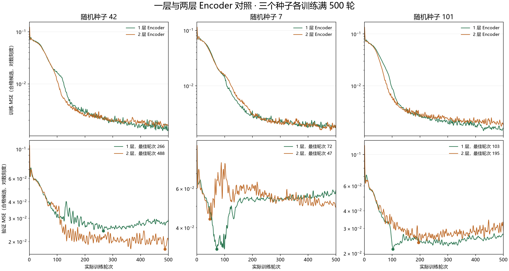

# 一层与两层 Transformer Encoder 对照

实验日期：2026-11-05。当前结果没有显示两层 Encoder 稳定优于一层。根据对照结果及轻量化目标，项目已选定一层 Encoder 作为当前方案；网站使用原有的一层模型，两层权重保留用于实验对照。

## 实验设置

- 对照仅改变 Transformer Encoder 深度：1 层或 2 层；异构图均为 1 层。
- 两组均使用 `wide_compact`：16 维、4 个注意力头、前馈维度 32、dropout 0.1、双向评分头隐藏维度 32。
- AdamW，学习率 0.003，weight decay 0.01；合格候选 MSE 加权重 0.02 的双向排序损失。
- 数据种子 31415；训练 96 个旅人 × 72 个地陪，其中 673 对合格候选；验证 32 × 24，其中 79 对合格候选。
- 随机种子均为 42、7、101，每个成员实际训练满 500 轮，不启用早停。各成员独立按验证集最低合格候选 MSE 选取权重，再平均双向输出。
- 两层中新增的 Encoder 块独立初始化。相同种子控制随机源，不表示不同架构的其他参数具有完全相同的初始值。

下表中的一层基线是此前的 **500 轮实验集成**，不是网站当前部署的最多 180 轮版本。

## 结果

新增合成评估使用基础数据种子 271828，64 个旅人和 48 个地陪，3,072 对中有 295 对满足本合成评估的城市、服务和语言条件。两组均使用验证集选出的权重；没有根据这次评估重新选择成员。

| 指标 | 一层 Encoder | 两层 Encoder |
| --- | ---: | ---: |
| 三成员总参数 | 54,678 | 61,350 |
| 验证集合格候选 MSE，越低越好 | 0.020279 | 0.020394 |
| 新合成评估合格候选 MSE，越低越好 | 0.024808 | 0.026915 |
| 新合成评估旅人方向 MAE | 0.147712 | 0.144399 |
| 新合成评估地陪方向 MAE | 0.081244 | 0.099769 |
| 综合分在旅人侧的 NDCG@5，越高越好 | 0.992173 | 0.990302 |
| 综合分在地陪侧的 NDCG@5，越高越好 | 0.980409 | 0.985416 |
| 本机 CPU 热身后前向中位耗时 | 36.5 ms | 63.7 ms |

耗时使用 2 个 CPU 线程，热身 5 次、测量 20 次，每次评分 295 对；不含加载权重、构图和 HTTP。它是本机短时测量，不是完整网站响应时间。

两层的合格候选 MSE 增加约 8.5%，旅人方向 MAE 略降、地陪方向 MAE 升高，两侧排序指标也有升有降。参数增加约 12.2%，本次前向测量耗时增加约 74.5%。这些结果不足以支持替换现有模型。

| 成员种子 | 一层最佳轮次 | 两层最佳轮次 |
| --- | ---: | ---: |
| 42 | 266 | 488 |
| 7 | 72 | 47 |
| 101 | 103 | 195 |



图中展示关闭 dropout 后计算的训练与验证合格候选 MSE，纵轴为对数刻度；不是包含排序项的训练总损失。每个验证曲线上的圆点是该成员保存权重的轮次。

## 文件与复现

- 模型支持：`server/matching_model.py` 的 `encoder_layers` 参数，默认仍为 1，兼容已有权重。
- 两层最佳验证权重集成：`output/matching_500_encoder2/ensemble_best.pt`。
- 两层第 500 轮权重集成：`output/matching_500_encoder2/ensemble_epoch500.pt`。
- 各成员权重与完整 500 轮记录：同目录下 `member_42`、`member_7`、`member_101` 的 `.pt` / `.json`。
- 对照指标：`output/matching_500_encoder2/depth_comparison.json`。
- PNG / SVG 图：`训练图表/Encoder一层与两层_500轮损失对照.*`。

在项目根目录使用现有虚拟环境：

```powershell
# 重新训练两层版本，会覆盖同目录的实验结果
.\.venv\Scripts\python.exe tools/train_matching_500.py --encoder-layers 2
# 读取已有的一层和两层 500 轮权重，生成指标与曲线
.\.venv\Scripts\python.exe tools/compare_encoder_depth.py
.\.venv\Scripts\python.exe tools/plot_encoder_comparison.py
```

这些命令不会更新 `server/models/matching.pt`。当前架构图仍描述网站部署的一层模型。

## 评估边界与验证

新增评估人物未用于训练，但仍使用已有 confirmation 句型族与同一个规则生成器，不能称为全新文字分布测试，也不能代表真实用户的匹配、接受或成交效果。现有标签来自合成规则；分数不代表接受概率。

新增回归检查覆盖两个 Encoder 块独立初始化、两层均获得梯度、保存后通过实际网站加载器恢复并得到一致预测。

完成上述改动后，使用项目虚拟环境运行 `python -m unittest discover -s tests -v`：44 项测试全部通过，包含匹配、账号、预约、私聊、命令行及提交打包检查。
