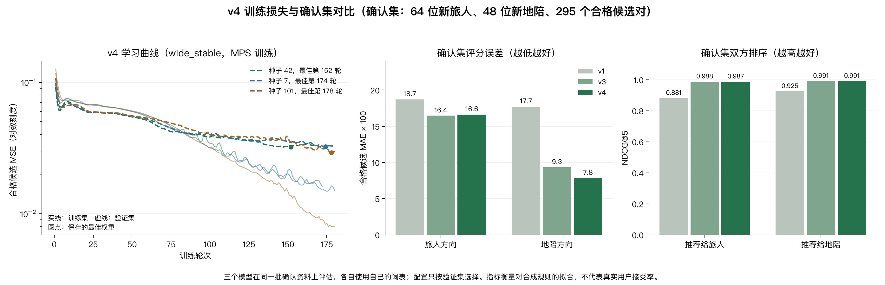

# 匹配模型优化：实验与验收

> 注：本文记录 v3 的优化过程。当前部署为 v4，见 [匹配算法完整说明](匹配算法完整说明.md)。

本次改动把训练过程、模型选择与最终验收分开。所有结果都来自合成偏好，不是用户接受记录，也不是对真实推荐质量的证明。

## 实际修改

1. 每轮关闭 dropout 后，用相同定义同时记录训练／验证 MSE 和双向 MAE；保存验证最优权重，使用早停与梯度裁剪。
2. 按人物及主题描述句模板划分数据；词表仅来自训练集。标签来自生成时的潜在偏好，不靠解析固定句子生成。结构化类别与部分通用文案仍共享。
3. 先比较缩小模型、dropout、weight decay、较低学习率与辅助排序损失，再做三个种子的复验。
4. 第二轮为评分头加入服务覆盖、双方共同兴趣比例和节奏相交四个显式输入，并把回归与排序训练集中到合格候选。仍保留 Transformer 与异构图，梯度／消融测试验证二者参与输出。
5. 按验证集的双边排序 NDCG@5 选中三种子的小模型集成；在新保留的确认集上一次验收，达到双向误差下降且两边综合排序均不退步的条件后晋级。

## 第一轮没有成功的尝试

同一套人物／主题模板分离的数据上，初始种子 42 的验证集全组合平均双向 MAE：原结构重训约 0.182，缩小模型约 0.249，缩小并正则化约 0.251，进一步降低学习率约 0.266。直接减小模型或学习率没有改善该实验。

原结构重训虽然降低误差，但在探索性测试上地陪侧综合排序退步，未晋级。该测试已经被查看，因此第二轮没有再把它当作未见测试。原始结果保留于 `matching_first_experiment_report.json`，包含各个种子及失败结果。

## 第二轮的选择和数据范围

固定数据种子 31415，训练 96 位合成旅人与 72 位合成地陪，构造 6,912 对；在其中满足城市、服务、共同语言条件的 **673 对候选**中训练。验证有 32 × 24 人、768 对，其中 79 对合格。这里的配对不是互相独立的新用户，不能把组合数当作独立人物数。

三种配置分别使用种子 42、7、101。最终选择 `wide_compact`，每个成员 18,226 参数：16 维、4 头、1 层 Transformer、1 层异构图、0.1 dropout、AdamW 学习率 0.003、weight decay 0.01，辅助双向排序损失权重 0.02。最多 180 轮，按验证合格候选 MSE 保留各成员最佳轮次。集成共 54,678 参数，比初版 84,674 少约 35%。

配置选择使用验证集上两侧综合排序 NDCG@5 的平均值，同分再比较验证合格候选 MSE。小模型和大模型集成的验证排序差异很小，不足以证明小模型普遍更好。

## 同场确认结果

模型选择完成后，才构造新保留的确认集：64 位旅人、48 位地陪，共 3,072 对；其中 295 对满足城市／语言／服务约束。这一合成基准没有模拟预算、日期与预约，因此其可行性约束比线上候选筛选窄。

| 确认集指标 | 初版 v1 | 新版 v3 集成 |
| --- | ---: | ---: |
| 合格候选旅人方向 MAE | 0.22248 | **0.15682** |
| 合格候选地陪方向 MAE | 0.16904 | **0.07126** |
| 合格候选 MSE | 0.07913 | **0.02636** |
| 综合分旅人侧 NDCG@5 | 0.89258 | **0.98745** |
| 综合分地陪侧 NDCG@5 | 0.93036 | **0.99206** |

前两项换成 100 分制约为 22.2 → 15.7 分、16.9 → 7.1 分的平均误差，分别减少约 30% 与 58%。NDCG 是排序指标，不是准确率；仅评价至少有两个候选且目标增益非零的查询，综合排序分别计入 54 个旅人查询与 41 个地陪查询。

常量预测和标签教师规则都保留在报告中。教师规则本身就是合成标签来源，所以天然误差为零、NDCG 为 1；本模型不能据此宣称超过规则方法。集成三个成员的确认集结果也全部记录，未只展示最好的随机种子。

## 尚未解决的限制与代价

- 学习曲线仍有训练／验证差距，没有消灭过拟合。保存最佳轮次的作用是控制验证退步，不是证明真实泛化。
- 新版针对硬筛后的候选。全组合旅人 MAE 从 0.212 变为 0.528，明显变差；地陪方向从 0.182 变为 0.076。全量误差没有被隐藏，但不作为此候选排序器的晋级指标。以后若取消硬筛，必须重新训练和验收。
- 增加合成人物不能替代真实数据。新增文字仍来自人工模板，真实用户表达和偏好可能更复杂。应收集获同意的曝光、选择及双方接受／拒绝记录，做按用户和时间划分的评价。
- 三模型集成增加计算次数。本机 CPU、2 线程、112 个角色节点和 295 对候选，20 次预热后的前向中位耗时约 **14 ms → 36 ms**；未包括图构建、首次加载或 HTTP，用时不能当作网页端到端延迟。



> 上图与 `matching_inference_timing.json` 已由 `tools/plot_matching_optimization.py` 按当前部署的 v4 重新生成（v1 / v3 / v4 在同一确认集上对比，CPU 中位耗时约 25 / 66 / 111 ms）；上文 14 ms → 36 ms 为 v3 当时的测量。

## 复现与文件

```powershell
# 单个候选：输出到 output/matching_training，不覆盖在线模型
.\.venv\Scripts\python.exe tools/train_matching.py --preset wide_compact --epochs 180

# 固定配置、多种子、验证选择与确认晋级
.\.venv\Scripts\python.exe tools/refine_matching.py --epochs 180

# 所有测试
.\.venv\Scripts\python.exe -m unittest discover -s tests -v

# 可选：重画曲线并测量本机推理耗时（需要 matplotlib）
.\.venv\Scripts\python.exe -m pip install matplotlib
.\.venv\Scripts\python.exe tools/plot_matching_optimization.py
```

`matching_refinement_report.json` 是完整确认报告；`matching_inference_timing.json` 记录本机计算开销；`server/models/matching.json` 记录当前部署与成员选择信息。模型权重仅训练自合成资料，初版备份为 `matching_v1.pt`。实验输出及各成员曲线在 `output/matching_refinement/`，重新运行实验会写入这些实验文件。

这些固定确认数据一旦被查看，后续调参就必须保留新的、未参与选择的评价数据，不能反复优化同一确认结果并继续称其为“独立测试”。
