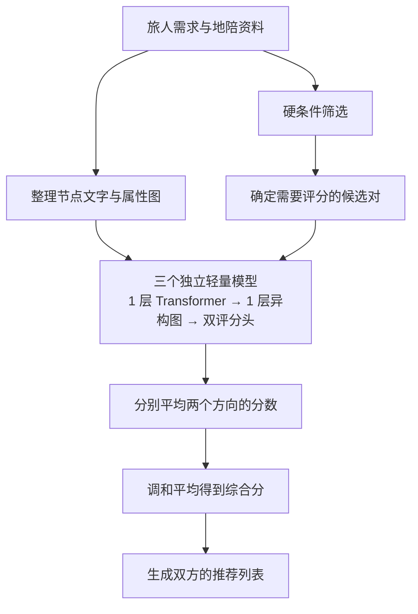
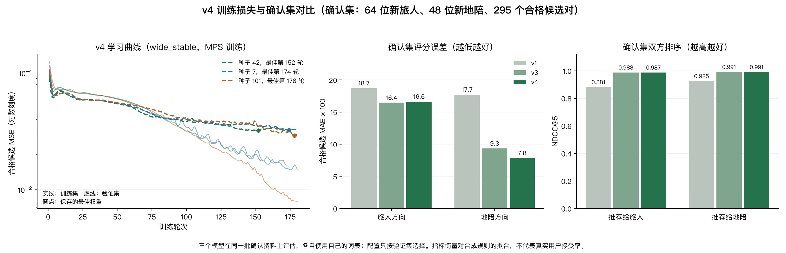

# 青禾双边匹配算法完整说明

本文对应当前网站部署的一层轻量方案，整理日期为 2026-11-05。

模型名称：`TinyTransformer-HeteroGNN-v4-ensemble`（2026-11-05 由 v3 重训，修复文本覆盖不足与截断问题；v3 权重保留在 `server/models/matching_v3.pt`）。

## 1. 算法概述

青禾使用结合**硬条件筛选、轻量 Transformer 文本编码、异构图传播和双向评分**的推荐算法，为旅人推荐地陪，也为地陪推荐行程，同时考虑双方的偏好。

当前采用三个独立模型集成。每个成员使用 **1 层 Transformer Encoder 和 1 层异构图传播**，三个成员独立训练后平均输出。



## 2. 双方输入信息

匹配的基本单位是“一条旅人行程”和“一条地陪服务”。同一地陪账号发布的不同服务分别形成服务节点。

| 旅人填写 | 地陪提供 |
| --- | --- |
| 城市、日期、开始时间、服务时长 | 服务城市、套餐、价格、服务类型 |
| 同行人数、整团预算、沟通语言 | 沟通语言、最大接待人数、接单星期、休息日期 |
| 兴趣、旅行节奏、需求描述 | 服务介绍、希望接待的旅行兴趣与节奏、文字偏好 |

日期、预算、人数和档期主要用于硬条件筛选；文字、兴趣、服务、语言等信息参与神经模型评分。

旅人保存行程前需要同意向符合条件的地陪展示需求。地陪需要主动填写接待偏好，系统使用其实际提供的信息计算地陪方向的分数。

## 3. 硬条件筛选

候选组合需要满足以下条件：

- 地陪服务处于发布状态，且不属于旅人本人。
- 旅人与地陪处于同一城市。
- 地陪提供旅人需要的全部服务。
- 双方至少有一种共同沟通语言。
- 存在符合旅人所选时长的套餐。
- 整团报价不超过预算，同行人数不超过地陪接待上限。
- 行程出发日属于地陪接单星期，且不在休息日期内。
- 行程起止时间与已有预约没有重叠。
- 地陪已填写双边接待偏好。

存在多个同等时长套餐时，选择价格最低的套餐。报价沿用网站的业务规则：

$$
P_{\mathrm{total}}=P_{\mathrm{package}}+60\times\max(0,n-4)
$$

其中，$n$ 为同行人数，单位为人民币元。超过四人的部分，每人增加 60 元。

同一地陪账号发布的不同服务共享档期。待确认和已确认的预约都会占用时段，取消后释放。冲突检查使用实际起止时间，可以识别跨午夜的重叠。

模型只对通过硬条件的候选组合评分，首先保证推荐具备业务上的可行性。

## 4. Transformer 文本编码

### 4.1 文字组织与字符表示

系统把城市、服务、语言、兴趣、节奏、需求描述或服务介绍等字段拼接为文字。旅人行程、地陪服务及属性节点的文字共用一套文本编码器。

文字按字符转换为编号，每个节点最多处理拼接后文字的前 256 个字符（截断由模型按自身位置编码长度完成，`tensor_graph` 只设 512 字的内存上限）。词表只使用训练文字构建；填充字符使用编号 0，未登录字符使用编号 1。

为了让编码器适应真实用户文字，v4 做了两项处理：

1. 合成资料加入与标签无关的自由文字（沟通方式、性格、行程安排等），句库不含兴趣、节奏、服务、城市词，且训练、验证、测试、确认四个划分互不重复。填充句使用独立随机数生成器，人物属性和教师标签与 v3 数据完全一致。词表由 116 个字符扩大到 284 个。
2. 训练时把 15% 的有效字符随机替换为未登录编号（`unknown_rate`），推理时关闭。模型因此学会在大量未知字符中依靠已知关键词。

在 `server/data.json` 的 7 位真实地陪资料上：未登录字符比例由 51.6% 降到 24.6%，文字保留比例由 80.5% 提高到 100%，文字对评分的平均影响由 0.038 提高到 0.077（把地陪文字全部替换为未登录字符时的分数变化）。

编码过程为：

```text
字符编号
  → 字符嵌入 + 可学习位置嵌入
  → 1 层 Transformer Encoder
  → 对有效字符做均值池化
  → 加入节点类型嵌入
  → 得到 32 维初始节点表示 r_v
```

填充字符通过掩码排除，不参与最终均值池化。

### 4.2 当前配置

| 配置 | 数值 |
| --- | --- |
| Encoder 层数 | 1 |
| 多头注意力头数 | 4 |
| 表示维度 | 32 |
| 前馈网络 | 32 → 64 → 32 |
| 前馈激活函数 | GELU |
| 训练 dropout | 0.1 |
| 每个节点的文字长度上限 | 256 个字符 |
| 训练时未登录字符替换比例 | 15% |

多头注意力作用于每个节点内部的字符序列，学习文字之间的上下文联系。字符嵌入、位置嵌入和 Encoder 均从头训练。

## 5. 异构图构建与传播

### 5.1 七类节点

| 节点类型 | 含义与示例 |
| --- | --- |
| 旅人行程 `traveler` | 某条上海摄影行程 |
| 地陪服务 `guide` | 某条本地陪游服务 |
| 城市 `city` | 上海 |
| 服务类型 `service` | 拍照陪游 |
| 语言 `language` | 中文 |
| 兴趣 `interest` | 摄影 |
| 节奏 `pace` | 慢慢逛 |

旅人行程和地陪服务分别连接对应的属性节点。地陪的兴趣边来自其填写的“希望接待的旅行兴趣”。

同一城市、服务、语言、兴趣或节奏使用共享属性节点。图包含 **10 种正向关系和对应的 10 种反向关系**。

### 5.2 按关系分别聚合

不同关系拥有独立的线性变换参数，例如 `traveler_interest` 与 `guide_interest` 使用不同的参数。

对节点 $v$，模型先将各入边来源的信息按关系变换，再对全部入边进行平均聚合：

$$
m_v=\frac{1}{|N(v)|}\sum_{(u,r,v)}W_r r_u
$$

其中，$N(v)$ 表示节点 $v$ 的入边邻居，$W_r$ 表示关系 $r$ 的线性变换，$r_u$ 是来源节点的初始表示。

随后结合节点自身信息：

$$
h_v=\operatorname{LayerNorm}\left(
r_v+\operatorname{Dropout}\left(
\operatorname{ReLU}(W_{\mathrm{self}}r_v+b+m_v)
\right)\right)
$$

得到 32 维图表示 $h_v$。这里使用一层传播，让双方节点吸收直接相连的城市、服务、兴趣等属性信息；双方的成对交互还通过后续特征表达。

多头注意力负责文字编码，异构图负责按关系聚合属性信息。图中只构建已知属性关系，不把待预测的接受、匹配或标签关系加入输入图。

### 5.3 双方共享图上下文

网站使用开放行程和服务资料构建统一的图上下文，再为通过筛选的候选对计算分数。旅人视图和地陪视图使用相同的上下文，使同一时刻、同一对行程与服务的双向分数一致。

## 6. 成对特征构建

对旅人行程 $t$ 和地陪服务 $g$，拼接以下特征：

$$
x_{tg}=[r_t,r_g,h_t,h_g,r_t\odot r_g,h_t\odot h_g,c_{tg}]
$$

其中，$\odot$ 表示逐元素相乘。

| 特征 | 维度 |
| --- | ---: |
| 旅人文字初始表示 $r_t$ | 32 |
| 地陪文字初始表示 $r_g$ | 32 |
| 旅人图表示 $h_t$ | 32 |
| 地陪图表示 $h_g$ | 32 |
| 初始表示的逐元素交互 $r_t\odot r_g$ | 32 |
| 图表示的逐元素交互 $h_t\odot h_g$ | 32 |
| 显式相容性特征 $c_{tg}$ | 4 |
| **合计** | **196** |

四个显式相容性特征为：

1. 所需服务的覆盖比例。
2. 共同兴趣占旅人兴趣的比例。
3. 共同兴趣占地陪接待偏好兴趣的比例。
4. 双方旅行节奏是否相交。

这些特征来自双方填写的信息。

## 7. 双向评分与三成员集成

### 7.1 两个独立评分头

两个评分头接收同一个 196 维成对特征，但各自拥有独立参数：

$$
T_k=\sigma\left(\operatorname{MLP}_{\mathrm{traveler},k}(x_{tg})\right)
$$

$$
G_k=\sigma\left(\operatorname{MLP}_{\mathrm{guide},k}(x_{tg})\right)
$$

每个评分头的结构为：

```text
196 维输入 → 64 维隐藏层 → GELU → 1 维输出 → Sigmoid
```

$T_k$ 是第 $k$ 个模型给出的旅人方向偏好分，$G_k$ 是地陪方向偏好分，范围均为 0–1。

两个方向可以不同。例如旅人很喜欢某项服务，但该地陪对这类行程的接待偏好较低。

### 7.2 三成员集成

使用随机种子 42、7、101 分别训练三个独立成员，再分别平均两个方向的输出：

$$
T=\frac{T_1+T_2+T_3}{3},\qquad
G=\frac{G_1+G_2+G_3}{3}
$$

单模型有 **73,058 个参数**，三个成员合计 **219,174 个参数**（v3 为 54,678）。在 3072 个候选对上 CPU 推理约 117 ms（v3 约 69 ms）。每个成员都是一层 Encoder，集成阶段平均成员输出。

## 8. 综合分与推荐排序

使用两个方向平均分的调和平均，计算综合分：

$$
S=100\times\frac{2TG}{T+G}
$$

当两个方向的分数之和为零时，综合分为零。调和平均使单方向很高、另一方向很低的组合受到抑制。

| 旅人方向（百分制） | 地陪方向（百分制） | 综合分 |
| ---: | ---: | ---: |
| 90 | 20 | 32.7 |
| 70 | 70 | 70.0 |

计算顺序是先分别平均成员的旅人分和地陪分，再求调和平均。

网页显示旅人分、地陪分和综合分，保留一位小数。列表按综合分降序排列，同分时优先总价较低的候选，再按地陪服务编号和行程编号稳定排序。

最终输出的是推荐列表，双方自行沟通和确认预约。页面上的匹配理由来自已核对的条件和共同兴趣。旅人可以从推荐结果进入预约，地陪可以联系符合条件的旅人；行程撤回后停止参与地陪推荐。

## 9. 训练数据与监督目标

### 9.1 当前使用合成数据

训练数据模拟了 **96 个旅人、72 个地陪，共 6,912 对组合**，包含苏州、上海、杭州三个城市，以及兴趣、服务、语言、节奏和相应描述文字。

其中有 **673 对**满足训练阶段的同城、服务和语言条件，模型重点学习这些候选。线上预算、人数与档期由业务筛选处理。

验证数据为 32 个旅人和 24 个地陪，共 768 对组合，其中 79 对满足上述合成评估条件。训练与验证使用不同人物和不同主题句模板，词表只读取训练文字。

### 9.2 两个方向的教师评分

模拟器根据不同方向的偏好生成目标分：

$$
y_T=0.65I_T+0.25C+0.10P
$$

$$
y_G=0.70I_G+0.30P
$$

各变量的含义为：

| 符号 | 含义 |
| --- | --- |
| $I_T$ | 地陪擅长兴趣与旅人兴趣的交集，占旅人兴趣的比例 |
| $C$ | 地陪提供的服务覆盖旅人所需服务的比例 |
| $I_G$ | 旅人兴趣与地陪希望接待的兴趣的交集，占地陪接待偏好兴趣的比例 |
| $P$ | 双方旅行节奏是否相交，相交为 1，否则为 0 |

旅人目标分关注地陪是否擅长自己需要的内容；地陪目标分关注旅人的兴趣是否符合自己希望接待的类型。

模拟器中的 `expertiseInterests` 字段用于生成地陪擅长主题和监督标签，字段本身不进入模型图或显式成对特征，相关主题会体现在生成的服务文案中。

以上权重用于生成训练标签；网站运行时的偏好分由训练后的神经模型输出。

## 10. 损失函数与训练配置

### 10.1 训练目标

训练损失由双向评分误差和双向排序损失组成：

$$
\mathcal{L}=\mathcal{L}_{\mathrm{MSE}}+0.02\mathcal{L}_{\mathrm{rank}}
$$

MSE 让两个方向的预测接近教师目标分。排序损失分别比较旅人侧和地陪侧的候选顺序，使用基于 logits 差值的 softplus 成对排序形式。训练时只使用符合条件的比较，并忽略教师分数差距小于 0.15 的近似并列候选。

### 10.2 当前部署配置

| 配置项 | 数值 |
| --- | --- |
| 优化器 | AdamW |
| 学习率 | 0.001 |
| 训练设备 | Apple MPS（`--device auto/cpu/mps`，保存的权重统一在 CPU） |
| Weight decay | 0.01 |
| 排序损失权重 | 0.02 |
| Dropout | 0.1，推理时关闭 |
| 梯度裁剪上限 | 1.0 |
| 单成员训练轮数上限 | 180 |
| 部署版本早停 patience | 25 |
| 成员权重选择 | 验证集合格候选 MSE 最低的轮次 |

当前部署成员的训练记录为：

| 随机种子 | 实际训练轮次 | 保存权重的最佳轮次 |
| --- | ---: | ---: |
| 42 | 172 | 152 |
| 7 | 180 | 174 |
| 101 | 180 | 178 |

v4 按 v3 的协议重跑三种配置 × 三个种子，在验证集上按双方 NDCG@5 选中 `wide_stable`，随后在确认集上一次性验收并晋级。同一确认集上与 v3 对比：旅人方向合格候选 MAE 0.166（v3 0.165），地陪方向 0.078（v3 0.093），NDCG@5 各项差距在 0.001 以内。完整报告见 [matching_refinement_v4_report.json](matching_refinement_v4_report.json)。



左图为三个成员的训练、验证损失：验证损失在约 150–178 轮趋于平稳，训练损失继续下降，因此按验证集最低点保存权重。图表由 `tools/plot_matching_optimization.py` 生成，同时复制到 `训练图表/优化前后对照.png`。

此前的一层、两层各 500 轮对照权重保存在独立实验目录。项目已根据对照结果和轻量化目标选定一层方案，具体见 [Encoder 深度对照](ENCODER_DEPTH.md)。

## 11. 评估与适用边界

模型使用评分误差和双方推荐排序指标进行评估，包括合格候选 MSE、两个方向的 MAE，以及综合分在双方列表中的 NDCG@5。

当前模型学习的是人工设定的合成偏好及其文字表现。虽然训练、验证和确认数据使用不同人物和不同主题句模板，但结构化类别、数据生成规则和部分文案样式仍然共享。

因此，当前结果适合用于说明模型训练、双向偏好评分和网站推荐流程。真实用户的接受、拒绝和成交效果仍需实际数据验证；网页推荐分应理解为偏好排序分，不能解释为接受概率或成交概率。

文本编码的已知限制：地陪简介最多 600 字，超出 256 字的部分不会被读取；合成训练文字最长约 222 字，更靠后的位置编码未经训练；真实文字仍有约四分之一字符不在词表中。由于数据生成器和预设已更新，`output/` 下 v4 之前的实验报告无法用当前代码原样复现。

## 12. 相关代码位置

以下路径以项目根目录为基准，链接相对于本文档所在的 `docs` 目录。

| 内容 | 文件 | 主要位置 |
| --- | --- | --- |
| 文本组织、构图与张量化 | [server/matching_model.py](../server/matching_model.py) | `profile_text`、`make_graph`、`tensor_graph` |
| 异构图传播 | [server/matching_model.py](../server/matching_model.py) | `HeterogeneousLayer` |
| Transformer 与双评分头 | [server/matching_model.py](../server/matching_model.py) | `TinyBilateralMatcher` |
| 三成员集成与调和平均 | [server/matching_model.py](../server/matching_model.py) | `MatcherEnsemble`、`reciprocal_score` |
| 硬条件、档期、模型加载和排序 | [server/matching_service.py](../server/matching_service.py) | `candidate`、`availability_reason`、`load_engine`、`rank_pairs` |
| 合成资料与教师标签 | [server/matching_data.py](../server/matching_data.py) | `synthetic_profiles`、`teaching_targets` |
| 数据分区、损失与成员训练 | [tools/train_matching.py](../tools/train_matching.py) | `partition`、`ranking_loss`、`train` |
| 集成配置选择与部署验收 | [tools/refine_matching.py](../tools/refine_matching.py) | `run` |
| 匹配资料与推荐接口 | [server/matching_api.py](../server/matching_api.py) | 匹配接口处理 |
| 网页匹配界面 | [public/js/pages/matching.js](../public/js/pages/matching.js) | 旅人与地陪两侧交互 |
| 当前部署权重与元数据 | [server/models/matching.pt](../server/models/matching.pt)、[server/models/matching.json](../server/models/matching.json) | 三成员权重与训练记录 |
